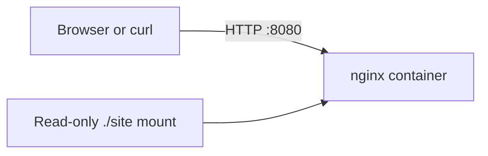

# Static page container lab

## Goal

Run one container that serves a static page, prove it responds over HTTP, and tear it down without leaving a container, volume, network, or billable resource.

## Architecture

The editable source is in [`architecture.mmd`](architecture.mmd).



## Prerequisites

- Linux
- Docker with the Compose plugin
- GNU Make
- `curl`

No cloud account, paid tool, or secret is used. Port `8080` is the safe default in `.env.example`; copy it to `.env` only to override the port locally.

## Run it

```sh
make up
make verify
```

Open <http://localhost:8080> or the port selected in `.env`.

## What I learned

- Compose gives the lab a repeatable lifecycle and isolated resource names.
- A health check proves the service is ready, while `verify` checks user-visible behaviour.
- Teardown should be tested just like startup, including an explicit absence check.

## Teardown

```sh
make down
```

This lab creates only local Docker resources. `make down` removes containers, anonymous/named volumes, and the Compose network, then fails if a project container or network remains.
