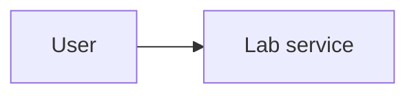

# Lab title

## Goal

State the skill you are practising and the observable result.

## Architecture

The editable diagram source is in [`architecture.mmd`](architecture.mmd).



## Prerequisites

- Linux
- Docker with the Compose plugin
- GNU Make
- `curl`

Copy `.env.example` to `.env` only when local overrides are needed. Never commit `.env` or credentials.

When copying this template, rename the lab in one place only: change the top-level `name:` in `compose.yaml`. The teardown script reads that value automatically for its resource checks.

## Run it

```sh
make up
make verify
```

### Continuous integration

The repository-level workflow in [`.github/workflows/labs.yml`](../.github/workflows/labs.yml) runs `make up`, `make verify`, and `make down` for every lab on pushes and pull requests. Teardown uses `if: always()` and fails the job if a labeled container, network, or volume remains, so even a failed verification is followed by a checked cleanup.

The workflow lives at the repository root because GitHub only discovers workflows under `.github/workflows/`; a matrix supplies each lab directory as its working directory. This keeps one visible workflow for all copied labs, at the cost of adding each new lab directory to the matrix once.

Action dependencies are pinned to full commit SHAs with a version comment. Tags can be moved to different code, while a commit SHA is immutable and makes the runner input reviewable.

## What I learned

- Replace this with one technical lesson.
- Replace this with one troubleshooting lesson.
- Replace this with one design trade-off.

## Teardown

```sh
make down
```

`make down` must delete every local resource created by `make up`. If a lab adds cloud infrastructure, extend `scripts/down.sh` to destroy it and add a provider query that fails when anything remains. A lab is not complete until that check passes.
